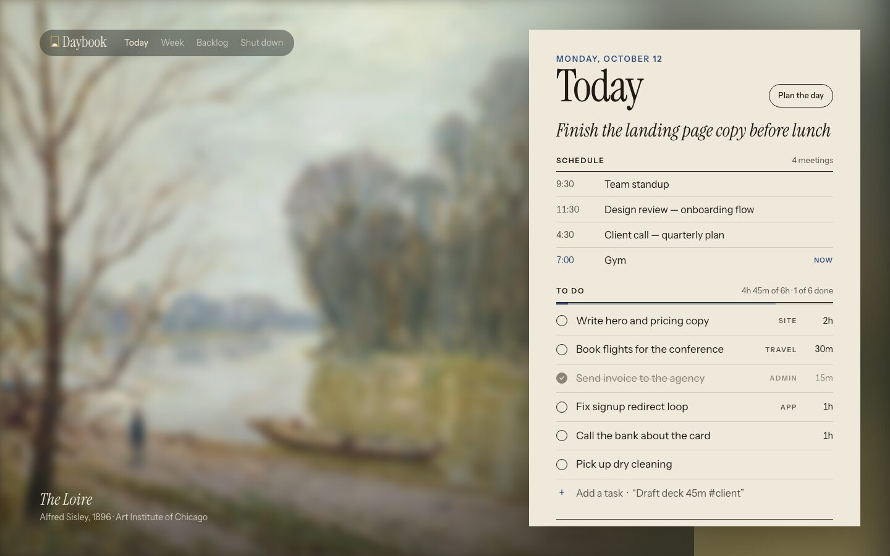
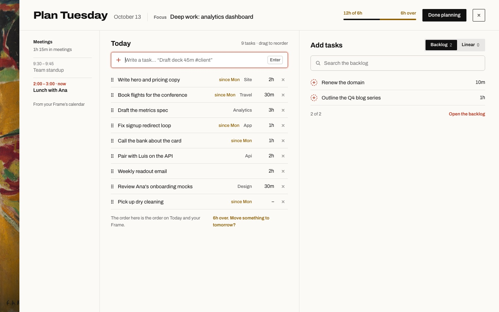
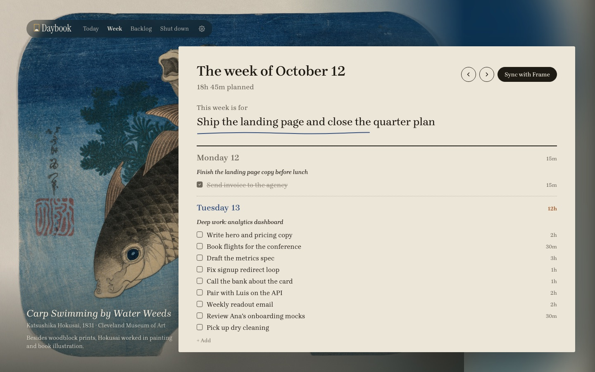
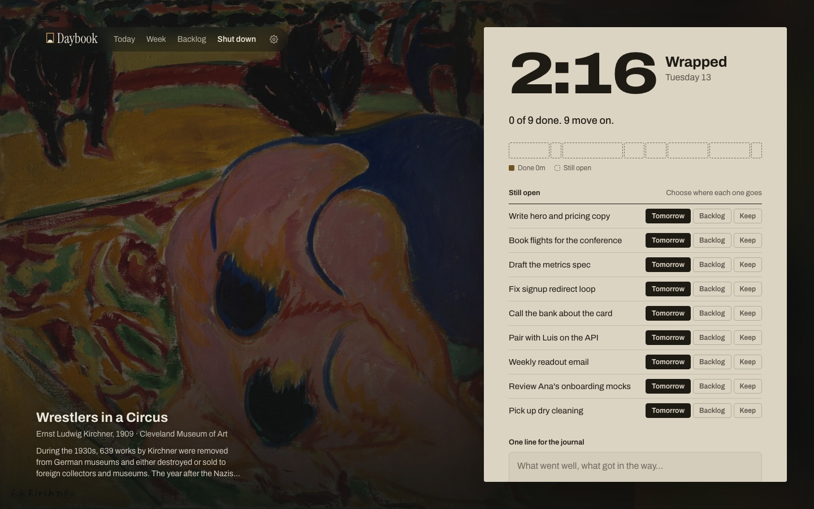

# Daybook

A super simple daily planner with a painting of the day. Plan the morning,
shut down in the evening, and let your AI agents do the typing.

[daybooksalon.vercel.app](https://daybooksalon.vercel.app) ·
[Watch it in 50 seconds](https://daybooksalon.vercel.app/film/daybook-film.mp4) ·
[Download for Mac](https://github.com/joseamijares/daybook/releases/latest/download/Daybook.dmg)



## Get started

Daybook opens on one button. Press **Start** and your days stay in that
browser: free, private, no account, no setup. When you want the same days on
every device, the Mac app, AI agents, Linear or your Frame, run your own
Daybook in the cloud and open it with its key.

- **In a browser.** Deploy Daybook with no settings at all
  ([one click on Vercel](https://vercel.com/new/clone?repository-url=https%3A%2F%2Fgithub.com%2Fjoseamijares%2Fdaybook)),
  or [run it on your computer](#run-it). Open it and press **Start**. To keep
  it as an app: the install icon in Chrome or Edge, File → Add to Dock in
  Safari, Share → Add to Home Screen on an iPhone or iPad.
- **In your own cloud.** Vercel and Upstash on their free plans, and a key you
  make: see [Deploy your own](#deploy-your-own). Then choose **Open it with
  your key** under Start.
- **On a Mac.** [Download Daybook.dmg](https://github.com/joseamijares/daybook/releases/latest/download/Daybook.dmg),
  drag it into Applications and open it. It asks once for your cloud
  Daybook's address and key, and updates itself from then on.
- **With your AI agents.** In a cloud Daybook, Settings → AI agents makes a
  token and the exact setup for Claude, ChatGPT, Cursor, Codex and more. See
  [Connect your agents](#connect-your-agents).

## What's in it

Daybook is a small, open-source take on [Sunsama](https://www.sunsama.com/)'s
rituals. It shares its look and its 44 public-domain paintings with
[Frame Dashboard](https://github.com/joseamijares/frame-dashboard). With a
Frame connected, Daybook hangs whatever painting the TV shows that day, with its
story; without one, it uses the same rotation as the Frame's Impressionists pack.

- **Today.** One focus line, a short list of tasks with time estimates, and
  how much you've planned against your capacity (6 hours by default).
  Unfinished tasks roll over to the next day and remember where they started.
  Click a task to rename it, tag it, time it or move it.
- **Plan the day.** Planning takes the whole window: your meetings in a narrow
  column, the day you're building in the middle, and only tasks on the right,
  from the backlog or from Linear. Write new ones (into the day or the
  backlog), edit or delete them without leaving the plan, and reorder by
  dragging: the other rows step aside to show where a task will land.
- **Week.** One card with a column per day, Sunsama style. Drag backlog items
  onto a day, and each day turns amber when it's over capacity.
- **Shut down.** The same painting at dusk. You see what got done, choose
  where unfinished work goes (tomorrow, the backlog, or stay), and write one
  line for the journal.
- **Agents first.** A built-in MCP server works with Claude, Cursor, Codex,
  ChatGPT, Grok and any other MCP client. It has tools for every action and
  prompts for the morning, evening and Monday rituals. There's also a REST
  API and a small CLI.
- **Linear.** Your open assigned issues land in the backlog. Finishing one in
  Daybook completes it in Linear.
- **Frame Dashboard.** Two-way sync with your TV and Frame Desk. To-dos ticked,
  added or removed there come back to Daybook, Daybook's week goes to the TV,
  and the TV's meetings show up on Today. Pick the TV's design (painting by
  day, salon, or painting always) from the Week screen, the Mac app or an agent.
- **On this device, or in your own cloud.** The first screen has one Start:
  your days stay in the browser, with no account and no backend. Once a week
  Today asks you to keep a copy, and Settings → Your data exports one, imports
  one, or erases everything. The same file moves you to a cloud Daybook later;
  "Have your own Daybook? Open it with your key" under Start opens one.
- **Three designs, three palettes.** A museum wall label, a timetable with wide
  numerals and blocks of time, or a written notebook; in Salon (bone and
  cobalt), Modern (white and one red dot) or Nocturne (blue-black and gilt).
  Settings → Appearance, with an option to turn to Nocturne after shutdown.
- **Mac app.** The full Daybook in a window, a glance at today in the menu
  bar, a shutdown reminder, and Frame sync every two minutes. It opens on a
  wall of paintings and updates itself. Signed and notarized: [download Daybook.dmg](https://github.com/joseamijares/daybook/releases/latest/download/Daybook.dmg)
  (macOS 14+, Apple silicon and Intel). See [mac/README.md](mac/README.md).

| Plan the day (Timetable, Modern) | Week (Notebook) |
| --- | --- |
|  |  |

| Shut down (Timetable) |
| --- |
|  |

## Run it

You need Node 20 or later and pnpm 10.

```bash
pnpm install
cp .env.example .env.local      # optional locally: works with no key and stores data in .data/
pnpm dev                        # http://localhost:3000
```

Without `DAYBOOK_KEY`, `pnpm dev` lets in anyone who can reach it (it listens
on your network too) and keeps its data in `.data/daybook.json`. Any other
server without a key, `pnpm start` included, offers only "on this device".

The UI is in English or Spanish (`DAYBOOK_LOCALE=en|es`), and the time zone
that decides "today" is `DAYBOOK_TZ`.

## The landing page

[daybooksalon.vercel.app](https://daybooksalon.vercel.app) is Daybook's public page
(`site/`): the painting of the day in a salon hang, the rotation, the Frame, the
Mac app and how to install it. It is its own Next.js app and Vercel project
(Root Directory `site`); see [site/README.md](site/README.md).

## Deploy your own

[](https://vercel.com/new/clone?repository-url=https%3A%2F%2Fgithub.com%2Fjoseamijares%2Fdaybook)

**Just the app.** Deploy with no settings at all. Everyone who opens it uses
Daybook on their own device: their days stay in their browser, and the server
keeps nothing. No database, no key.

**A cloud Daybook (Vercel + Upstash).** For the same days everywhere, the Mac
app, agents, Linear and Frame:

1. Import the repo in Vercel. Under *Storage → Create Database → Upstash for
   Redis* (the free plan is enough), connect it to the project. That sets
   `KV_REST_API_URL` and `KV_REST_API_TOKEN`.
2. Set `DAYBOOK_KEY` (`openssl rand -hex 24`), `DAYBOOK_TZ`, and optionally
   `LINEAR_API_KEY`, `FRAME_DASHBOARD_URL` and `FRAME_DASHBOARD_WRITE_KEY`.
   [.env.example](.env.example) explains each one.
3. Set `CRON_SECRET` too. Vercel Cron then calls `/api/cron/sync` once a
   day (see `vercel.json`) to sync Linear and the Frame. On a Pro plan you
   can make it every 10 minutes (`*/10 * * * *`).
4. Deploy, open the site, choose **Open it with your key** under Start, and
   enter your key once in each browser you use.
5. In the Mac app, set the URL to your deployment and paste the same key.

When you deploy a new version, pages that are already open show a small
**Update** mark beside the Settings gear; a click reloads them.

### How it fits together

```
 Web app ─┐                                  ┌─ Frame Dashboard (its own Vercel project)
 Mac app ─┼─▶ Daybook on Vercel ─▶ Upstash   │    TV + Frame Desk edit its plan
 Agents  ─┘   (/api, /api/mcp)   ◀─ sync ───▶┘    (two-way, three-way merge)
  (MCP)                          ◀─ sync ─── Linear
```

Daybook on Vercel is the one source of truth. The web app, the Mac app and
your agents all read and write it with the same key. Frame sync is
server-side, using `FRAME_DASHBOARD_URL` and `FRAME_DASHBOARD_WRITE_KEY`, and
it runs:

- after every change, when `FRAME_AUTO_SYNC=true`;
- every 2 minutes while the Mac app is open;
- on the Vercel Cron schedule;
- when you press **Sync with Frame**.

A cloud Daybook needs storage (Upstash on Vercel) and `DAYBOOK_KEY`; without
them a deploy only offers "on this device". Anyone with the key can read and
change your plan, so treat it like a password.

## Connect your agents

Open **Settings** (the gear in the navigation). For Linear and Frame
Dashboard, paste their keys; Daybook checks them and stores them encrypted.
For an AI client, pick it from the list:

- Claude, ChatGPT, Cursor and Grok;
- Claude Code, Codex, Gemini CLI, VS Code and Windsurf;
- Meta Llama Stack, or any other MCP client.

Daybook creates a token just for that client and shows the exact setup, with
a one-click install for Cursor and VS Code. Revoke a token there at any time.

To do it by hand: the MCP endpoint is `https://<your-daybook>/api/mcp` (Streamable HTTP, JSON
responses). Agents authenticate with `Authorization: Bearer <DAYBOOK_KEY>`.
For clients that can't send headers, such as ChatGPT connectors, use
`?key=<DAYBOOK_KEY>` instead.

```bash
DAYBOOK_URL=https://your-daybook.vercel.app DAYBOOK_KEY=… node cli/daybook.mjs setup           # print every snippet
DAYBOOK_URL=… DAYBOOK_KEY=… node cli/daybook.mjs setup cursor codex --write                    # write configs (with backups)
```

| Client | How |
| --- | --- |
| Claude Code | `claude mcp add --transport http daybook <url>/api/mcp --header "Authorization: Bearer <key>"` |
| Cursor | `~/.cursor/mcp.json` → `{ "url": "<url>/api/mcp", "headers": { "Authorization": "Bearer <key>" } }` |
| Claude Desktop | stdio relay `node cli/daybook.mjs mcp`, or *Settings → Connectors* with the URL |
| Codex | `~/.codex/config.toml` → `[mcp_servers.daybook]` using the stdio relay |
| ChatGPT | *Developer mode → Create connector* with `<url>/api/mcp?key=<key>`, no auth |
| Grok | Grok Build: `~/.grok/config.toml` like Codex. Grok on the web / Grok Bot: a custom connector with the URL |
| Meta Llama Stack | Register a `model-context-protocol` tool group with the URL |

See [docs/agents.md](docs/agents.md) for the full setup, the tool list and the
REST API. Then ask your agent to "plan my day".

## CLI

```bash
node cli/daybook.mjs today
node cli/daybook.mjs add "Draft deck 45m #client" --date tomorrow
node cli/daybook.mjs done <id>
node cli/daybook.mjs mcp          # stdio MCP relay for clients without remote MCP
```

## Development

```bash
pnpm verify     # lint, typecheck, tests, production build
```

| Path | What |
| --- | --- |
| `app/` | The screens (`/`, `/plan`, `/week`, `/backlog`, `/shutdown`, `/settings`) and the API under `app/api/` |
| `components/` | The salon shell, the placards, and task rows |
| `lib/daybook.ts` | The domain: tasks, days, weeks, rollover, planning, shutdown |
| `lib/mcp.ts` | The MCP server: tools, prompts, JSON-RPC |
| `lib/linear.ts`, `lib/frame.ts` | The integrations |
| `lib/storage.ts` | The store interface the domain uses (no Node or browser imports) |
| `lib/store.ts` | The server's store: Upstash Redis, or a JSON file locally |
| `lib/localStore.ts`, `lib/localApi.ts` | "On this device": the store in localStorage, and the API answered in the browser |
| `lib/backup.ts` | Export and import a whole Daybook as one JSON file |
| `cli/daybook.mjs` | The CLI and stdio relay (no dependencies) |
| `mac/` | Daybook for Mac (SwiftUI): window + menu bar |
| `site/` | The landing page, its own Next.js app and Vercel project |

The design was drawn in Paper (the maintainer's file, not public); you don't
need it to contribute. Colours, type and spacing live in `app/globals.css` as
palette variables (`data-palette`) and per-design rules (`data-style`).

## Art and fonts

The 44 paintings are in the public domain. They are scans from
[Wikimedia Commons](https://commons.wikimedia.org/), shared with Frame
Dashboard and resized to WebP in `public/art/`. Each painting's source page is
in `lib/art.json`, and the credit on screen links to it.
[Schibsted Grotesk](https://fonts.google.com/specimen/Schibsted+Grotesk),
[Archivo](https://fonts.google.com/specimen/Archivo) and
[Brygada 1918](https://fonts.google.com/specimen/Brygada+1918) are under the
SIL Open Font License. The Mac app bundles
[Instrument Sans](https://fonts.google.com/specimen/Instrument+Sans) and
[Instrument Serif](https://fonts.google.com/specimen/Instrument+Serif), also
OFL, with their licence files.

## Contributing

Issues and pull requests are welcome. See [CONTRIBUTING.md](CONTRIBUTING.md),
and report security issues privately as described in
[SECURITY.md](SECURITY.md).

## License

MIT for the code.
